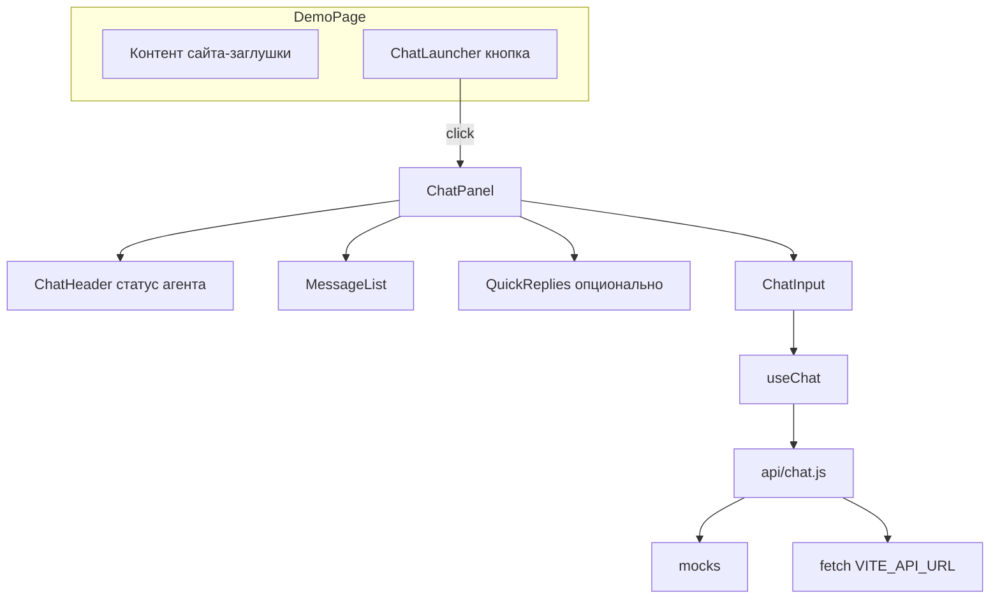

# Frontend чата ИИ-агента в стиле Jivo

## Контекст

Репозиторий сейчас содержит только правило [`.cursor/rules/mock-data.mdc`](D:\Students\wed 1500\11\ai-chat\.cursor\rules\mock-data.mdc). Код приложения отсутствует — создаём проект целиком.

Выбор: **виджет** (кнопка + окно) на **демо-странице**; ответы — **моки + готовый слой API**.

## Стек

| Слой | Решение |
|------|---------|
| Сборка | Vite |
| UI | React 18, JSX, без TypeScript |
| Стили | CSS-переменные + один файл [`src/components/ChatWidget/chat-widget.css`](src/components/ChatWidget/chat-widget.css) (BEM-подобные классы) |
| Состояние чата | Хук `useChat` (локальный state, без Redux) |

## UX и визуал (ориентир Jivo)



- **Лаунчер**: фиксированно `bottom-right`, круглая кнопка с иконкой чата, лёгкая тень; при открытии — смена на «закрыть» или скрытие лаунчера (как у Jivo).
- **Панель**: ~380×min(600px, 85vh), скругление ~16px, тень; на узких экранах — почти на весь экран с отступами.
- **Шапка**: фирменный зелёный градиент (`--chat-brand`), аватар агента, имя («ИИ-ассистент»), подпись «Онлайн», кнопки свернуть/закрыть.
- **Сообщения**: пузыри пользователя справа (светло-серый/бренд), агента слева с аватаром; время мелким текстом; автоскролл к последнему.
- **Приветствие**: первое сообщение агента из моков + чипы **быстрых ответов** (3–5 фраз из мока).
- **Индикатор**: «Ассистент печатает…» на время `sendMessage` (мок-задержка 600–1200 ms).
- **Ввод**: textarea (Enter — отправка, Shift+Enter — перенос), кнопка отправки; disabled во время «печати».

Демо-страница [`src/App.jsx`](src/App.jsx): простой лендинг (заголовок, пара блоков текста), чтобы виджет выглядел как встраиваемый на сайт.

## Структура файлов

```
ai-chat/
  package.json
  vite.config.js
  index.html
  .env.example          # VITE_API_URL=, VITE_USE_MOCKS=true
  src/
    main.jsx
    App.jsx
    index.css             # reset + demo page
    mocks/
      agent.mock.js       # имя, avatar (URL или initials), status
      messages.mock.js    # начальная история (3–6 сообщений)
      quickReplies.mock.js
      responses.mock.js   # шаблоны ответов по ключевым словам / default
    api/
      chat.js             # fetchMessages, sendMessage, USE_MOCKS
    hooks/
      useChat.js
    components/
      ChatWidget/
        ChatWidget.jsx    # open state, монтирует Launcher + Panel
        ChatLauncher.jsx
        ChatPanel.jsx
        ChatHeader.jsx
        MessageList.jsx
        MessageBubble.jsx
        ChatInput.jsx
        QuickReplies.jsx
        TypingIndicator.jsx
        chat-widget.css
    utils/
      formatTime.js       # локаль ru-RU для createdAt
```

## Данные и API

**Модель сообщения** (JSDoc в `messages.mock.js`):

- `id`, `role`: `'user' | 'assistant'`, `text`, `createdAt` (ISO)

**[`src/api/chat.js`](src/api/chat.js)** — по образцу из правила проекта:

```javascript
const USE_MOCKS =
  import.meta.env.VITE_USE_MOCKS === 'true' || !import.meta.env.VITE_API_URL;
```

- `fetchMessages()` — при моках: `structuredClone(MOCK_MESSAGES)`; иначе `GET ${VITE_API_URL}/messages`.
- `sendMessage(text, { history })` — при моках: задержка + выбор ответа из `responses.mock.js` (простые правила: приветствие, цена, поддержка, fallback); иначе `POST ${VITE_API_URL}/chat` с `{ message, history }`, ожидание `{ reply }` или `{ message }` (один контракт задокументировать в комментарии).

**[`src/hooks/useChat.js`](src/hooks/useChat.js)**:

- Инициализация: загрузка истории через `fetchMessages` (или сразу моки в state после mount).
- `sendUserMessage(text)`: append user → `isTyping` → `sendMessage` → append assistant → clear typing.
- Обработка ошибок: одно системное сообщение агента «Не удалось отправить. Попробуйте ещё раз.»

## Интеграция в приложение

- [`src/main.jsx`](src/main.jsx): рендер `App`.
- [`src/App.jsx`](src/App.jsx): разметка демо-сайта + `<ChatWidget agent={MOCK_AGENT} />` в конце DOM (вне основного контента, `position: fixed` внутри виджета).

## Запуск и проверка

1. `npm install` → `npm run dev`
2. Открыть localhost: виджет в углу, история из моков, быстрые ответы, отправка нового сообщения с индикатором печати.
3. Для проверки API-слоя: в `.env` задать `VITE_API_URL=http://...` и `VITE_USE_MOCKS=false` (без сервера — ожидаемая ошибка и fallback-сообщение; документировать в `.env.example`).

## Что сознательно не входит в scope

- Реальный бэкенд и стриминг токенов (можно добавить позже в тот же `sendMessage`).
- Отдельный embed-скрипт для сторонних сайтов (только React-виджет на демо-странице).
- Storybook / тесты (по запросу).

## Порядок реализации

1. Scaffold Vite React (JS), базовые стили демо-страницы.
2. Моки (`agent`, `messages`, `quickReplies`, `responses`).
3. `api/chat.js` с переключением мок/API.
4. Компоненты виджета снизу вверх: пузырь → список → шапка → ввод → панель → лаунчер → `ChatWidget`.
5. `useChat` и связка с API.
6. Полировка: адаптив, focus/accessibility (`aria-label` на кнопках, `role="log"` у списка сообщений).
